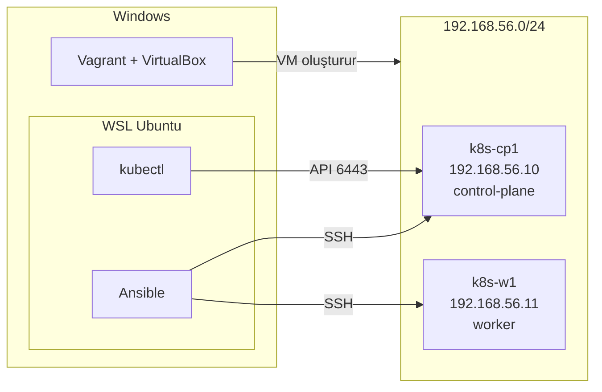

# E2E DevOps Platform — Infrastructure

[E2E DevOps Platform](https://github.com/MustafaOgur/e2e-devops-platform) projesinin altyapı reposu. VirtualBox VM'leri üzerinde iki node'lu bir Kubernetes cluster'ını Vagrant ve Ansible ile koddan kurar.

## Kurulum Yolları

| | kubeadm | k3s |
|-|---------|-----|
| Komut | `make kubeadm` | `make k3s` |
| Kubernetes | v1.37 | v1.37 |
| Container runtime | containerd 2.x | k3s ile gelen containerd |
| CNI | Cilium | Flannel |
| Kullanım | Tam kurulum; yeterli kaynak gerektirir | Kısıtlı donanım; projede kullanılan ortam |

İki yol aynı VM'leri kullanır, aynı anda kurulamaz. İkisi de iki node `Ready` ve kapat-aç testiyle doğrulandı.

## Mimari



| VM | Rol | vCPU | RAM | IP |
|----|-----|------|-----|----|
| `k8s-cp1` | control-plane | 2 | 3,5 GB | `192.168.56.10` |
| `k8s-w1` | worker | 2 | 4,5 GB | `192.168.56.11` |

Pod ağı `10.244.0.0/16` kullanır.

## Gereksinimler

| Nerede | Gereksinim |
|--------|-----------|
| Windows | VirtualBox 7.1+, Vagrant 2.4+ |
| WSL Ubuntu | `ansible`, `make`, `kubectl` |
| Donanım | En az 4 çekirdek, 12 GB RAM |

## Kurulum

**1. SSH anahtarı (WSL, repo kökünde):**

```bash
ssh-keygen -t ed25519 -f ~/.ssh/k8s-lab -N "" -C "k8s-lab"
mkdir -p vagrant/ssh && cp ~/.ssh/k8s-lab.pub vagrant/ssh/
```

**2. VM'ler (Windows PowerShell):**

```powershell
cd vagrant
vagrant up
```

**3. Cluster (WSL, repo kökünde):**

```bash
make ping
make k3s          # veya: make kubeadm && make kubeadm-kubeconfig
make nodes
```

Kubeconfig `~/.kube/config` konumuna yazılır.

## Kullanım

| Komut | Açıklama |
|-------|----------|
| `make help` | Komutları listeler |
| `make ping` | Node'lara erişimi test eder |
| `make check` | Playbook sözdizimini kontrol eder |
| `make kubeadm` | kubeadm ile kurulum |
| `make kubeadm-kubeconfig` | kubeadm için kubeconfig ve kubectl |
| `make k3s` | k3s ile kurulum |
| `make nodes` | Node'ları listeler |
| `make pods` | Pod'ları listeler |

VM'ler `vagrant/` klasöründen yönetilir: `vagrant up`, `vagrant halt`, `vagrant status`, `vagrant destroy -f`.

## Kendi Ortamında Kullanma

Roller tek control-plane ve istenen sayıda worker'la farklı cluster'lar kurmak için kullanılabilir.

**Worker eklemek için** node'u `vagrant/Vagrantfile` içindeki `NODES` listesine ve `ansible/inventory/hosts.ini` içindeki `[workers]` grubuna ekleyip kurulum komutunu tekrar çalıştır.

**Kendi sunucularında** `hosts.ini` içindeki IP'leri ve `ansible.cfg` içindeki `remote_user` ile `private_key_file` değerlerini değiştir. Roller Ubuntu 24.04 ve amd64 için yazılmıştır; k3s yolunda node'lar arası ağ kartı `vars/k3s.yml` içindeki `k3s_flannel_iface` ile belirlenir.

Birden fazla control-plane (HA) desteklenmez: `[control_plane]` grubuna birden fazla node yazılırsa birbirinden bağımsız cluster'lar oluşur.

## Repo Yapısı

```text
vagrant/Vagrantfile        VM tanımları
ansible/
├── inventory/hosts.ini    Node'lar ve gruplar
├── site.yml               kubeadm kurulumu
├── k3s.yml                k3s kurulumu
├── kubeconfig.yml         kubeadm için kubeconfig ve kubectl
├── vars/k3s.yml           k3s ayarları
└── roles/                 common, containerd, kubernetes, control_plane, worker, k3s_server, k3s_agent
Makefile                   Sık kullanılan komutlar
```
